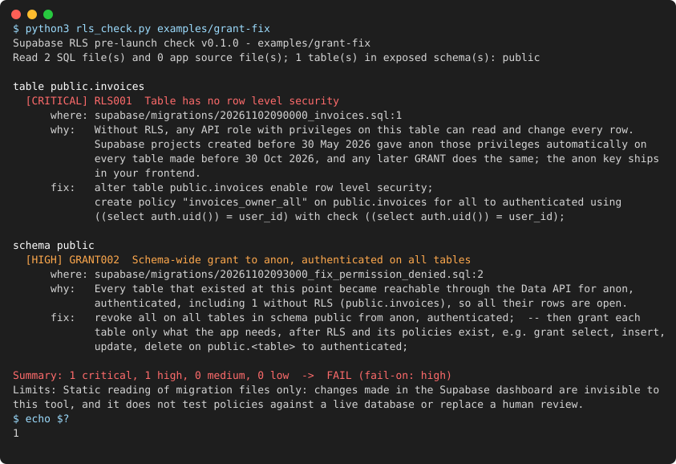

# Proofmerge RLS Check: a Supabase RLS pre-launch checker

One Python file that reads your Supabase migrations and app source **offline** and tells you, in plain language, where Row Level Security is missing or wide open before you launch. Built for founders who shipped with Lovable, Bolt, Cursor, v0 or similar tools.

Python 3.10+ standard library only. No install, no account, no network calls. It never prints secret values.

> **Not a security audit.** The tool looks for 13 known misconfiguration patterns in files. A clean report means none of them matched; it does not certify that your app or your Supabase project is secure, and it does not test anything against a live database. See [Limitations](#limitations) and the [walkthrough](examples/WALKTHROUGH.md) for what it misses.



*Unedited output of v0.1.0 on [`examples/grant-fix`](examples/grant-fix) (lines wrapped): the common "42501 permission denied" quick fix that opens a table without RLS. Run `python3 rls_check.py examples/grant-fix` to reproduce it.*

## Install

No package manager needed: download one file.

```bash
curl -O https://raw.githubusercontent.com/dobravaza/proofmerge-rls-check/main/rls_check.py
sha256sum rls_check.py   # v0.1.0: b50ee6a168a68493db3f3b866506ef137a6156c94728de98ada5ac54ab94b419
```

## Privacy

Everything runs on your machine. The tool opens files under the folder you give it (symlinks pointing outside it are ignored), makes no network calls, needs no Supabase credentials, and prints keys only as "value redacted" with file and line. Nothing is sent to Proofmerge.

## Quickstart

```bash
python3 rls_check.py /path/to/your/project
python3 rls_check.py /path/to/your/project --html report.html
```

Try it on the bundled samples: `python3 rls_check.py examples/bad-project` (15 findings) and `python3 rls_check.py examples/good-project` (0 findings). [`examples/WALKTHROUGH.md`](examples/WALKTHROUGH.md) takes the bad project from 15 findings to a reviewed pass with the real output at each step, and lists what the tool did not catch.

If your schema was built in the Supabase dashboard, run `supabase db pull` (or `supabase db dump -f supabase/schema.sql`) first so there is SQL to read.

## What it checks

Migrations are applied in file-name order (`supabase/migrations/*.sql` first, then any other `*.sql`), so a later `ALTER`, `DROP` or `REVOKE` overrides an earlier statement. Findings describe the final state.

| Rule | Severity | What it finds |
|---|---|---|
| RLS001 | critical | Table in an exposed schema (`public`) without `ENABLE ROW LEVEL SECURITY` (also: policies written but RLS never enabled) |
| RLS002 | low | RLS enabled but no policy (nothing leaks, the app just gets empty results) |
| RLS003 | critical / high / medium / low | `USING (true)` / `WITH CHECK (true)`: critical for writes open to anon, high for writes open to any logged-in user, medium/low for anon read of everything |
| RLS004 | high | Table has an owner column (`user_id`, `owner_id`, `created_by`, `author_id`, or a reference to `auth.users`) but the policy never ties rows to `auth.uid()` / `auth.jwt()`, e.g. `auth.role() = 'authenticated'` |
| RLS005 | critical | RLS was enabled, then disabled in a later migration |
| FUNC001 | medium | `SECURITY DEFINER` function without a fixed `search_path` |
| VIEW001 | high | View in an exposed schema without `security_invoker = true` |
| STOR001 | high / medium | Storage bucket created or updated to `public` (high when the name suggests private files) |
| GRANT001 | high / medium / low | Explicit `GRANT ... TO anon` on a sensitive-looking table (payments, profiles, messages, ...) |
| GRANT002 | high / medium / low | `GRANT ... ON ALL TABLES IN SCHEMA public` or `ALTER DEFAULT PRIVILEGES ... ON TABLES` to `anon` / `authenticated`: high or medium when it opens tables without RLS, low otherwise |
| KEY001 | critical | Service-role key in a browser-exposed env var (`NEXT_PUBLIC_`, `VITE_`, `EXPO_PUBLIC_`, `REACT_APP_`, ...) |
| KEY002 | critical / high / medium | Service-role key referenced in a `"use client"` file, in `components/` or `pages/`, or elsewhere under `src/` or `app/` in a file that is not clearly server-side |
| KEY003 | critical | Hardcoded service-role JWT or `sb_secret_` key in source (value is never shown) |

Every finding has a severity, `file:line`, one sentence on why it matters, and the SQL (or step) to fix it.

## Example output

```
table public.messages
  [CRITICAL] RLS005  Row level security was switched off in a later migration
      where: supabase/migrations/20260915103000_fix_empty_messages.sql:2
      why:   The table was protected, then a later migration removed the protection. Any API role with privileges on it can now read and change every row; in Supabase projects created before 30 May 2026, anon held those privileges on every table made before 30 Oct 2026.
      fix:   alter table public.messages enable row level security;

table public.todos
  [CRITICAL] RLS003  Policy "Enable all access for all users" (all) allows writes with an always-true condition
      where: supabase/migrations/20260901090000_init.sql:18
      why:   The condition is always true, so anyone on the internet (no login needed) can insert, change or delete rows that belong to other people.
      fix:   drop policy if exists "Enable all access for all users" on public.todos;
             create policy "Enable all access for all users" on public.todos for all to authenticated using ((select auth.uid()) = user_id) with check ((select auth.uid()) = user_id);

Summary: 7 critical, 5 high, 2 medium, 1 low  ->  FAIL (fail-on: high)
```

### The 42501 quick fix (Supabase, after 30 Oct 2026)

New tables now answer `42501 permission denied` until they are granted, and a common fix is `grant all on all tables in schema public to anon, authenticated;`. `python3 rls_check.py examples/grant-fix` shows what that does to a table without RLS:

```
schema public
  [HIGH] GRANT002  Schema-wide grant to anon, authenticated on all tables
      where: supabase/migrations/20261102093000_fix_permission_denied.sql:2
      why:   Every table that existed at this point became reachable through the Data API for anon, authenticated, including 1 without RLS (public.invoices), so all their rows are open.
```

The safer fix: revoke the schema-wide grant, enable RLS and write the policy, then grant each table only what the app uses (for example `grant select on public.invoices to authenticated;`). [`examples/grant-fix-fixed`](examples/grant-fix-fixed) is the same project plus that migration ([`20261102100000_lock_invoices.sql`](examples/grant-fix-fixed/supabase/migrations/20261102100000_lock_invoices.sql)); `python3 rls_check.py examples/grant-fix-fixed` prints `0 critical, 0 high, 0 medium, 0 low  ->  PASS` and exits 0. A pass means none of the 13 known patterns matched, not that the app is secure.

The suggested SQL is a starting point. Read it before you run it: an owner-only policy is wrong for tables that are shared between team members.

## Options and CI

```
--json             machine-readable output
--html FILE        self-contained HTML report (no external assets, all content escaped)
--schemas a,b      exposed schemas to check (default: public)
--fail-on LEVEL    critical | high | medium | low (default: high)
--no-color
```

Exit code is `1` when there is a finding at or above `--fail-on`, `0` otherwise, `2` on a usage error. In GitHub Actions:

```yaml
- run: python3 rls_check.py . --fail-on high
```

## Limitations

- **Static reading of migrations.** It cannot see changes made in the Supabase dashboard or SQL editor that were never pulled into a migration file. If the files are out of date, so is the report.
- **It is not a substitute for testing policies against a live database or for a human review.** It does not run your policies, so it cannot tell whether a policy with a real condition is actually correct, only whether it matches a known bad pattern. A clean report means no known pattern matched, not that the app is secure.
- Pattern-based SQL parsing, not a full PostgreSQL parser. Dynamic SQL (`EXECUTE format(...)`), `BEGIN ATOMIC` function bodies and unusual formatting can be missed. A loop that enables RLS on all tables via `format()` is recognised; other dynamic SQL is not.
- Owner columns and "sensitive" tables are guessed from names. Expect some false positives (a deliberately public `profiles` table) and false negatives (an owner column called `member`).
- Policies that call a helper function are accepted when that function is defined in the migrations and uses `auth.uid()` / `auth.jwt()`; the helper's logic itself is not checked.
- Grants and the 30 Oct 2026 Supabase change. Until then, every new table in `public` was granted to `anon` and `authenticated` automatically, so a table without RLS was open to anyone with the anon key. Since 30 May 2026 for new projects and 30 Oct 2026 for existing ones, new tables get no API grants until a migration grants them; older tables keep theirs. The tool cannot see grants that were never written to a migration (including the ones Supabase applied by default), so it reports a table without RLS as critical either way: it is open now if the table predates the change, and it opens with the first `GRANT`, often added to fix a "permission denied" error. GRANT002 reports schema-wide grants and default privileges that do this to many tables at once.
- Storage object policies, column-level privileges, Realtime, Edge Function auth and API-route authorization are out of scope.
- The service-role key check works on file paths, directives and variable names (JS/TS, Vue, Svelte, Astro, `.env*`). Files marked `"use server"`, files that `import "server-only"`, and files under `server`, `api`, `functions`, `scripts`, `actions` or `middleware` paths are treated as server-side. It does not follow imports, so a server module imported into a client component is not detected.
- `examples/bad-project/src/lib/legacy.js` contains a fake, unsigned sample token so the hardcoded-key rule has something to find. Secret scanners may flag it; it is not a real key.

## Tests

```bash
python3 -m unittest discover -s tests -v
```

77 tests: a positive and a negative case per rule, security tests (no network access, secrets never printed in text/JSON/HTML, symlinks outside the project ignored, oversized and binary files skipped), `pg_dump`-style quoted SQL, output/CLI behaviour, the example projects end to end (`good-project` and `grant-fix-fixed` must produce zero findings), and the walkthrough's fix migration.


## Who made this

[Proofmerge](https://proofmerge.com) does human-reviewed security checks of AI-built apps before launch, at a fixed price (Launch Security Check, from US$790). This tool is the free, automated slice of the database part of that review. You do not need us to use it, and it sends nothing to us.

## License

MIT, see `LICENSE`. Security reports: see `SECURITY.md`.
